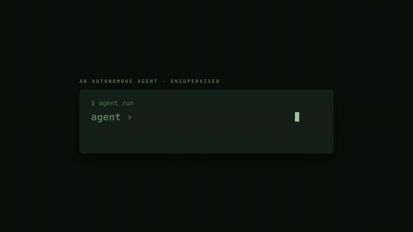

# counter-sign

**MCP gave agents tools. A2A gave agents colleagues. counter-sign gives agents a boss.**

[](https://www.npmjs.com/package/@countersignlabs/counter-sign)
[](LICENSE)
[](https://datatracker.ietf.org/doc/draft-kumaresan-counter-sign/)

**[countersignlabs.com](https://countersignlabs.com)** · [Spec](spec/countersign-spec.md) · [IETF Draft](https://datatracker.ietf.org/doc/draft-kumaresan-counter-sign/) · [Releases](https://github.com/countersign-labs/counter-sign/releases)

[](assets/countersign-brag.mp4)

counter-sign is an open protocol for agent-to-human authorization: an agent
signs its intent; a human countersigns it into authority.

The agent stack has a missing leg. MCP standardizes **agent-to-tool**. A2A
standardizes **agent-to-agent**. Neither says what happens at the moment
that actually matters — when an agent is about to do something irreversible
and needs a human's yes, on whatever channel that human actually reads.
counter-sign standardizes **agent-to-human authority** with four nouns and
nothing else:

- **Intent** — a signed JSON envelope: what the agent wants to do, the risk
  tier, who may approve it, how many must approve (`quorum`, for two-person /
  M-of-N control), how long to wait, and what silence means.
- **Route** — delivery to where approvers live (Telegram, Discord, Slack,
  WhatsApp, email) via deliberately dumb, pluggable adapters.
- **Countersignature** — a signed, portable receipt of the decision,
  verifiable offline by any party. The only artifact that conveys authority.
- **Default** — declared timeout behavior. Silence is never ambiguous.

Read the spec: [spec/countersign-spec.md](spec/countersign-spec.md) (~3 pages).
Also filed as an IETF Internet-Draft:
[`draft-kumaresan-counter-sign-00`](https://datatracker.ietf.org/doc/draft-kumaresan-counter-sign/).

## Quickstart

Add approval to any tool call in five lines:

```ts
import { wrapAction } from "@countersignlabs/counter-sign";
import { TelegramAdapter } from "@countersignlabs/counter-sign/adapters/telegram";

const deploy = wrapAction(deployProd,
  { action: "deploy.prod", summary: "Deploy v2.1.0 to production", risk_tier: "high",
    approvers: ["telegram:8675309"], timeout: 300, default: "reject" },
  new TelegramAdapter());
await deploy("v2.1.0");
```

On approve, `deployProd` runs. On reject — explicit or by timeout default —
it throws `IntentRejectedError` carrying the signed Countersignature as the
audit receipt. Try it with zero tokens:

```sh
npm install && npm run demo:local    # approver is you, at this terminal
npm run demo:email                   # full email flow, offline, no accounts
```

## Adapters

All seven adapters implement one interface — `deliver(intent)` plus a
decision callback returning a `Countersignature`. The five chat/email channels
are configured via env vars (see [.env.example](.env.example) and
[adapters/README.md](adapters/README.md) for setup); the local approver needs
none:

| Channel  | Setup effort | Interaction pattern |
| -------- | ------------ | ------------------- |
| Telegram | Low — a BotFather token | Buttons → callback webhook (or long-poll: no public URL needed) |
| Discord  | Medium — app + bot + public interactions endpoint | Buttons → interaction webhook (ed25519-verified) |
| Slack    | Medium — app, bot token, signing secret, public URL | Block Kit buttons → interactivity webhook (signature-verified) |
| WhatsApp | High — Meta app, approved template, webhook | Template quick-reply buttons → webhook (Meta Cloud API only) |
| Email    | Low — any SMTP credentials | Signed single-use links → confirm-page POST (GET never decides) |
| Signing link | Medium — mount a `SigningServer`, pick a delivery callback | Per-approver deep-links → passkey (WebAuthn) ceremony in the approver's browser |
| Local    | None | stdin approve/reject (demos, tests, CI) |

A Countersignature is byte-for-byte the same shape and equally verifiable
whichever adapter produced it — receipts don't care whether the yes came
from a chat button, an email link, or a passkey ceremony.

**What the chat adapters guarantee.** They refuse, before sending, a request
the platform would reject anyway (Telegram over 4096 characters, a Slack
section over 3000, a WhatsApp variable with a newline or tab). With
`enforceLimits: true` they also refuse what the platform might cut or reject
under its stricter count (UTF-16 code units; for WhatsApp, a template body
over 1024 characters or a run of four spaces), so an approver always sees the
full text they are approving. Each limit is an exported constant you can
override. Stricter identity settings are opt-in and leave 0.2.0 behaviour
alone until set: WhatsApp `recipientMode: "approvers"` sends the template to
the `whatsapp:<number>` approvers the Intent names (`"single"` sends to
`WHATSAPP_TO` and refuses anyone else's Intent; with no mode, every request
goes to `WHATSAPP_TO` as before), `requirePhoneNumberId` only believes
webhooks for your business number, and `confirmDecisions` replies to each
press. Set `SLACK_APP_ID` / `SLACK_TEAM_ID` so a correctly signed payload from
another Slack app or workspace is refused. In Telegram poll mode, a second
process polling the same bot fails waiting requests with
`TelegramPollingConflictError` instead of looping. After a decision, the
message says who decided and when, from the signed receipt. Setup for each is
in [adapters/README.md](adapters/README.md).

**Two-person / M-of-N approval.** Set `quorum: N` on an Intent to require N
*distinct* approvers before the action runs; any single approver vetoes. Two
strengths exist, and the Intent's `approvers` declare which one you get:

- **Vouched** (chat channels): the trusted authority observes the person's
  response and vouches for it with the authority key. That is enforcement, not
  proof — a holder of the authority key could mint such a receipt — so vouched
  slots are accepted only at `quorum: 1` (you may still list several vouched
  approvers; any one of them decides). Mixing a vouched slot into `quorum > 1`
  is rejected at construction.
- **Keyed** (`quorum > 1` requires it): every approver signs their own receipt
  with their **own key, which the authority never holds** — four-eyes becomes
  *cryptographic separation of duty*: a compromised authority server can neither
  forge the quorum nor swap an approver's bound key (each key is pinned inside
  the agent-signed Intent). A keyed approver signs either with a raw ed25519 key
  via the `approve` CLI, or with a **passkey** in their browser (next section).

Delivery constraints still apply per channel: the single-recipient **email**
adapter and single-terminal **local** adapter deliver `quorum: 1` only and
refuse more (neither can independently authenticate distinct humans), and the
chat/email/local adapters are vouched-only. The **signing-link** adapter
delivers keyed Intents whose approvers are all **passkeys**; a raw-keyed
(bot/CLI) approver signs out of band with the `approve` CLI instead of
receiving a link, so an Intent that mixes passkey and raw-keyed approvers
needs a custom delivery adapter — verification accepts the mixed quorum
either way.

## Passkey approvals (browser WebAuthn)

The human-grade keyed path: each approver taps a personal signing link, sees
what they are approving, and confirms with their passkey (Touch ID / Face ID /
security key). The resulting receipt is signed by *their* authenticator against
the credential bound in the Intent — the server only relays and verifies, so it
cannot forge an approval.

```ts
import { PendingDecisions, SigningServer, wrapAction } from "@countersignlabs/counter-sign";
import { SigningLinkAdapter } from "@countersignlabs/counter-sign/adapters/signing-link";

const server = new SigningServer({
  pending: new PendingDecisions(),
  authorityKey: process.env.COUNTERSIGN_AUTHORITY_KEY!,      // signs the single-use links
  webauthn: { rpId: "approve.example.com", allowedOrigins: ["https://approve.example.com"] },
  baseUrl: "https://approve.example.com",
});
httpServer.on("request", server.handler());                  // GET/POST /sign

const adapter = new SigningLinkAdapter({
  server,
  notify: ({ actor, url }) => sendHowYouLike(actor, url),    // email, chat DM, SMS…
});

const deploy = wrapAction(deployProd,
  { action: "deploy.prod", summary: "Deploy v2.1.0", risk_tier: "critical",
    approvers: [
      { actor: "m:ceo", mode: "keyed", public_key: CEO_PASSKEY },   // webauthn-p256:… | webauthn-ed25519:…
      { actor: "m:cto", mode: "keyed", public_key: CTO_PASSKEY },
    ],
    quorum: 2, timeout: 600, default: "reject" },
  adapter, { agent, authorityKey: process.env.COUNTERSIGN_AUTHORITY_KEY! });
```

Each link is single-use and expires with the Intent; the signing page is
self-contained (no external resources, CSP-pinned) and the assertion challenge
binds the approver's passkey signature to the exact receipt being minted —
decision, actor, intent and timestamp. Delivery fails closed: if no approver
could be reached (or any approver under `default: "approve"`), the action never
runs. Enroll approver credentials with the `enroll` CLI (an org-root-attested,
hash-chained registry); passkey receipts are covered by the conformance
vectors ([`vectors/`](vectors/)).

## Why receipts, not booleans

An approval that evaporates after the `if` statement is worth nothing in an
audit. A Countersignature is ed25519-signed, names the actor and the policy
(explicit approver vs. timeout default), pins the exact `intent_id`, and
verifies offline with no access to the system that produced it. Timeout
defaults produce receipts too — silence has a signature here.

**Integrity is not authority.** A receipt that verifies against its *own*
embedded key only proves it wasn't tampered with — anyone can mint one. To
*act* on a receipt, bind it to the authority you trust:

```ts
import { verifyCountersignature } from "@countersignlabs/counter-sign";
// Only true if the receipt was signed by an authority key you trust:
verifyCountersignature(receipt, { trustedKeys: [OUR_AUTHORITY_PUBLIC_KEY] });
```

The `wrapAction` shim does this for you: it only accepts a decision signed by
the same authority key the runtime holds, so the adapter that collects the
decision must share that key (set `COUNTERSIGN_AUTHORITY_KEY`).

Kaviyam is the first reference deployment.

## Approval history

counter-sign never persists on its own — it hands you signed receipts and lets
you decide where they live. Pass a `ReceiptLog` (opt-in) and every resolution —
approval, veto, or timeout Default — is durably recorded where the runtime is
installed, one canonical JSON line per receipt:

```ts
import { wrapAction, ReceiptLog } from "@countersignlabs/counter-sign";

const receiptLog = new ReceiptLog("./receipts.jsonl");
const refund = wrapAction(issueRefund, fields, adapter, { receiptLog });
```

The file records the audit trail, and it gives you two different guarantees —
one keyed and strong, one that depends on an anchor:

- **Authenticity (keyed).** Each line carries an independently verifiable
  Countersignature; a forged or altered receipt fails verification against the
  trusted authority key — *this* holds with no trust in the process that wrote
  the file, because the signatures are keyed. Recording completes *before* the
  guarded action runs, so an approval you cannot remember is one the runtime
  declines to act on.
- **Completeness (relative to an anchor).** Entries are hash-chained — every
  line commits to a SHA-256 of the one before it. The chain is **keyless**, so
  on its own it catches accidental corruption and naive edits, but it is **not**
  evidence against someone who can rewrite the file: they can recompute every
  downstream hash and produce an intact-looking chain. To get real
  tamper-evidence, checkpoint `head()` somewhere the writer cannot reach and
  verify against it — then *any* edit, reorder, insertion, deletion, or
  truncation at or below the anchor is caught (`diverged` / `truncated`).

```ts
const head = await receiptLog.head();   // { length, hash } — anchor this out of band
// …later, audit against your anchor:
const report = await receiptLog.verifyAll({ trustedKeys: [OUR_AUTHORITY_PUBLIC_KEY], expectedHead: head });
// { total, valid, ok, faults: [...], chain: { intact, brokenAt?, reason? } }
// ok === true  ⇢  every receipt is genuine AND the log is intact against your anchor.
// Without expectedHead, ok proves signatures + internal chain consistency — NOT
// that nothing was removed by a writer who re-chained.
const perIntent = await receiptLog.history(); // Map<intent_id, Countersignature[]>
```

`ReceiptLog` is a **single-writer** file-backed `ReceiptSink` (point separate
processes at separate files). For multi-writer storage or standalone
tamper-evidence that needs no external anchor, put SQLite, Postgres, or a
*signed* transparency log behind the `ReceiptSink` interface. (A keyed,
self-anchoring chain — a signed head on every append — is on the roadmap.)

**Durable before anyone acts.** Each append is flushed to disk (`fdatasync`)
before `record()` resolves, so the guarded action never runs on an approval a
power cut could take back; `{ fsync: false }` turns it off. Flushing each
append and restoring a lost final newline (see the changelog) are the
`ReceiptLog`'s new defaults; the flush adds latency to each append. (On macOS,
`fdatasync` reaches the drive but not always its cache.)

**A torn last line** (a crash in the middle of an append) makes reads throw, as
in 0.2.0, unless you opt in with `{ repairTornTail: true }`. Then:

- reads skip it, and `verifyAll` lists it in the report's `tornTails` (and
  `ok` is false). Reading never changes the file, so an auditor can open the
  log while the writer appends: a half-written line it happens to see is
  reported, never cut off;
- only the instance that appends repairs: before each append it moves a torn
  end into `receipts.jsonl.quarantine.jsonl` and cuts the log back to its last
  whole line. `await receiptLog.repair()` does the same on demand; call it only
  from the writer;
- each `tornTails` entry says whether its bytes are `quarantined` or still at
  the end of the file. It stays listed until you have looked at the quarantine
  file and archived it.

A bad line anywhere *else* is never repaired: reads throw, because that is not a
crash, it is damage. The `ReceiptFault` reasons are the same as in 0.2.0; torn
tails are reported only in `tornTails`, which is absent from a report unless the
log opted in or has a quarantine file.

**Keep the Intents too.** A vouched receipt names only an `intent_id`, so it
cannot be audited without the Intent it decides. Pass `{ intents: true }` and
each Intent is kept beside its receipts in `receipts.jsonl.intents.jsonl`,
written and flushed before them; the receipts file itself does not change.
`verifyAll` then uses the stored Intents when you supply none, checking each
one's agent signature, so an edited Intent faults its receipts instead of
vouching for them:

```ts
const receiptLog = new ReceiptLog("./receipts.jsonl", { intents: true });
// …
await receiptLog.verifyAll({ authorityKey: OUR_AUTHORITY_PUBLIC_KEY, trustedAgentKeys: [OUR_AGENT_PUBLIC_KEY] });
```

Any store works behind the `IntentStore` interface; `FileIntentStore` is the
file-backed default.

## Resumable decisions

`wrapAction` waits in memory, and so do the adapters. A restart forgets every
Intent still waiting, and an Intent waited on again afterwards has no memory of
being decided. When a decision may take hours or days, give it a
`PendingStore` and use `DurableDecisions`: issue the Intent now, resolve it
later, in this process or after a restart.

```ts
import { DurableDecisions, FilePendingStore, ReceiptLog } from "@countersignlabs/counter-sign";

const store = await FilePendingStore.open("./state/pending.jsonl");
const receiptLog = new ReceiptLog("./state/receipts.jsonl", { intents: true });
const decisions = new DurableDecisions({ adapter, store, receiptLog });

// At start-up, before anything else:
const { rearmed, lapsed, completed } = await decisions.restore();

// To ask:
await decisions.issue(intent);                 // stored, then delivered
const resolution = await decisions.decide(intent);
if (resolution.decision === "approve") await post();
```

Every decision goes in one order: the answer (or the Default) is verified, made
final in the store, written to the receipt log, and only then handed back.
`restore()` reads the store and, for each Intent:

- still inside its window: waits again for the time it has left, not a fresh
  window (re-delivering it if its first delivery never finished);
- deadline passed while the process was down: mints the signed Default;
- decided before the restart but not yet logged: logs it, and does not ask again;
- already holding a final receipt in the log: takes that decision, and does not
  ask again.

An Intent is decided once. The store's `finalize` is first-wins, and a decision
already in the store or the log is returned, never re-asked. If delivery fails
and reached nobody, the Intent is marked abandoned rather than left to time out
unseen. If it reached some approvers but not others (a `DeliveryPartialError`),
those reached already hold live buttons, so the Intent stays pending and their
answer counts; `issue()` returns the record with the approvers it missed in
`unreached` instead of throwing. Nothing delivers to only those: issue a new
Intent to ask them. In `restore()`, a re-delivery that fails outright abandons
the Intent only if no earlier delivery reached anyone; if one did, it stays
pending and re-armed, and the failure is listed in the report's
`redeliveryFailed`.

**One writer per store.** Run exactly one process per store file; the lock
catches mistakes, it is not a distributed lock. `FilePendingStore.open` takes a
lock file (`pending.jsonl.lock`, holding the pid, host, process start time and a
random token) and keeps it fresh with a heartbeat. A second process opening the
same store gets an error. On the same host a lock is taken over when its process
is gone, or when its heartbeat is older than `lockLeaseMs` (default 10 seconds; a
reused pid, or a wedged owner). A lock naming this process's own pid is the
container case: either an earlier run (a crash-restart, where the pid is the
same every time) or a live twin (two containers sharing a hostname and pid 1,
as with host networking and a shared volume). It is taken over only when its
last heartbeat predates this process and is older than two heartbeat intervals,
so a crash-restart opens at once (or after waiting out those two intervals, if
it restarted faster) and a live twin is refused. A lock from another host never
is taken over. Taking over is atomic, so of two processes starting together
exactly one gets the lock. Every write checks, before and after it appends, that
the lock is still this handle's and that the file holds only what this handle
wrote; if not, the write rejects, this handle does not act on it, and the handle
stops writing. If the event landed, the store's next holder (or the next open)
replays it, so a rejected issue may still be delivered and a rejected decision
may still be logged. The receipt log has the
same rule: one process writes each file.

`restore()` reads each Intent's deadline from the Intent itself. A record it
cannot restore (for example a stored Intent or decision that no longer verifies)
is listed in the report's `failed`, with the error, and the others are still
restored. A stored Intent is checked first, so an edited one is never delivered
again to anyone.

`wrapAction(fn, fields, adapter, { receiptLog, pendingStore: store })` uses the
same path (opt-in; without `pendingStore` nothing changes). It returns the
action's result, not the record: to learn which approvers a partial delivery
missed, pass `onDelivered: (record) => …` (the list is in `record.unreached`),
or read it from the store with `store.get(intent.intent_id)`. The wrapped function
does not run after a restart, since its arguments died with the process: act on
what `restore()` returns. Adapter authors can also hand a store to
`new PendingDecisions({ store })` and call `restore()` before the first `wait()`;
a decided Intent then stays decided across restarts. An adapter that takes
`pending` or `pendingStore` in its config (`PendingDecisionsSource`) builds its
book-keeping with `pendingDecisionsFor(config)`, which falls back to a new
in-memory `PendingDecisions` when neither is set.

## Compliance and evidence

counter-sign gives regulated teams a machine-enforceable, auditable
human-oversight control — and the evidence auditors ask for: a signed,
portable record of who authorized a consequential action, under which rule,
and when, with optional two-person / M-of-N sign-off for the most sensitive
actions. It is a mechanism for *implementing* oversight — such as the human
oversight expected under EU AI Act Article 14 (Regulation (EU) 2024/1689) —
not a guarantee of compliance; a protocol produces evidence, while
organizations are what pass audits. See [COMPLIANCE.md](COMPLIANCE.md) for how
a Countersignature maps to control areas in SOC 2, ISO/IEC 27001, the NIST AI
RMF, and EU AI Act Article 14.

## Admin console

Manage an org's policy — admin keys, roles, rules, and approver enrollments — and read the audit trail in a **local** console you run yourself:

```sh
npx @countersignlabs/console --data-dir ./my-org --open
```

It's single-org and self-hosted: it reads and writes only the data directory you point it at, has no login (the only authority is holding an admin key), and the admin's signing key never leaves the browser — each policy change is signed client-side and validated server-side against `verifyChain` plus a fail-closed semantic gate. Source: [`apps/console`](apps/console).

`resolveRule` turns a policy rule into an Intent's approvers. By default they are keyed, from the approver registry. For chat approvals, pass `{ approvers: "vouched" }` (quorum 1 only; a rule with any other quorum is refused, never downgraded) to get vouched approvers a chat adapter accepts, and add `channel: "slack"` to keep only that channel's members.

## Repository layout

| Path | What |
| ---- | ---- |
| `spec/` | The protocol specification |
| `schemas/` | JSON Schema (draft 2020-12) for Intent and Countersignature |
| `src/` | Reference implementation: core, shim, adapters (TypeScript, Node 20+, ESM) |
| `examples/` | One runnable demo per adapter + offline local/email demos |
| `adapters/` | Per-channel setup guides |
| `vectors/` | Language-neutral conformance vectors |
| `clients/python/` | Python client: verify receipts, create Intents (`create_intent`), and keep a receipt log in the reference's file format (`FileReceiptLog`) that either side can write and verify — see its [README](clients/python/README.md) |
| `docs/proposals/` | Written proposals from the first reference deployment (content binding, receipt deadlines, withdraw, a signed receipt chain, RFC 8785, resumable decisions, Route delivery). Not applied; the wire format is unchanged |

## Licensing

- **Code** (`src/`, `schemas/`, `examples/`, `tests/`): [Apache-2.0](LICENSE),
  Copyright 2026 Haridarman Kumaresan
- **Specification text** (`spec/`): CC BY 4.0 — see [LICENSE-CC-BY-4.0.txt](LICENSE-CC-BY-4.0.txt) (<https://creativecommons.org/licenses/by/4.0/>).
- Spec author: Haridarman Kumaresan.
